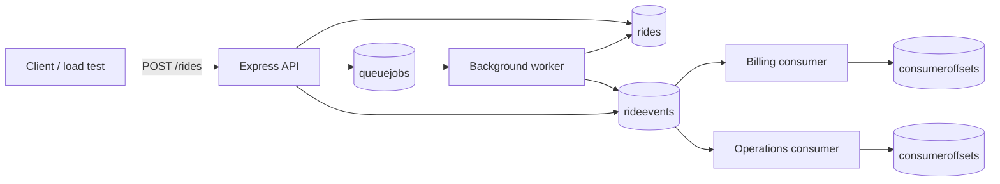

# Ride Dispatch System

A simple backend-only ride booking and driver dispatch system built with Node.js, Express, MongoDB, Mongoose and plain JavaScript ES modules.

This project is intentionally beginner-friendly: it uses small functions, clear names, simple polling workers/consumers, and MongoDB atomic operations for the important race-condition checks.

## Technologies used

- Node.js
- Express.js
- MongoDB
- Mongoose
- JavaScript ES modules (`import` / `export`)
- npm packages: `express`, `mongoose`, `dotenv`

## Folder structure

```text
ride-dispatch-system/
├── src/
│   ├── config/
│   │   └── db.js
│   ├── models/
│   │   ├── Ride.js
│   │   ├── QueueJob.js
│   │   ├── RideEvent.js
│   │   ├── ConsumerOffset.js
│   │   └── Counter.js
│   ├── routes/
│   │   └── rideRoutes.js
│   ├── services/
│   │   └── publishEvent.js
│   ├── workers/
│   │   └── rideWorker.js
│   └── consumers/
│       ├── billing.js
│       └── ops.js
├── scripts/
│   └── loadTest.js
├── .env.example
├── .gitignore
├── package.json
└── README.md
```

## Architecture



## How the complete system works

### 1. Ride booking flow

1. A client calls `POST /rides` with `riderName`, `pickup` and `drop`.
2. The API generates a unique `rideId` from the `Counter` collection.
3. The API creates:
   - a `Ride` document with status `REQUESTED`
   - a `QueueJob` document with status `PENDING`
   - a `RideEvent` document for status `REQUESTED`
4. The API immediately returns the `rideId`.

The writes are sequential for standalone MongoDB compatibility. If queue/event creation fails, the API attempts to remove the partially created ride/job.

### 2. Background worker logic

The worker runs as a separate process:

```bash
npm run worker
```

It repeatedly:

1. Atomically claims one `PENDING` job using `findOneAndUpdate`.
   - Only one worker can win each job because the update only matches `status: 'PENDING'`.
2. Loads the ride.
3. If the ride is missing or already final, marks the job `DONE`.
4. Creates a shuffled order of 10 fake drivers for that ride.
5. Simulates each driver response with 50% accept / 50% reject.
6. On accept:
   - It updates the ride only if it is still `REQUESTED` and has `driverId: null`.
   - This conditional update prevents one ride from being assigned to two drivers.
   - It publishes an `ASSIGNED` event and marks the queue job `DONE`.
7. On reject:
   - It increments `rejections` on the queue job and tries the next driver in the shuffled order.
8. After exactly 3 rejections:
   - It marks the ride `NO_DRIVER_FOUND`, publishes that event, and marks the job `DONE`.

### 3. Event publishing and consumers

Every ride status change is stored in the `rideevents` collection with a unique increasing `seq` number.

Two separate consumer programs read the same event collection:

- Billing consumer (`npm run billing`)
- Operations consumer (`npm run ops`)

Each consumer has its own document in `consumeroffsets`:

- `billing` offset
- `ops` offset

Consumers never delete events. They poll for events where `seq` is greater than their saved offset, process them in `seq` order, and update their own offset after each event. This gives every consumer the full event stream independently.

## API endpoints

| Method | Endpoint       | Description |
|--------|----------------|-------------|
| POST   | `/rides`       | Book a ride and queue it for dispatch |
| GET    | `/rides/:id`   | Get one ride by `rideId` |
| GET    | `/rides/stats` | Get ride counts by status |
| GET    | `/health`      | Simple health check |

### `POST /rides`

Request:

```json
{
  "riderName": "Nikhil",
  "pickup": "Mumbai",
  "drop": "Navi Mumbai"
}
```

Response:

```json
{
  "rideId": "RIDE-000001",
  "status": "REQUESTED"
}
```

## MongoDB setup

For local standalone MongoDB, make sure `mongod` is running and create/use the `ride-dispatch-system` database. For MongoDB Atlas, use your Atlas connection string instead.

Create `.env` from `.env.example` and set `MONGO_URI`.

Example for local standalone MongoDB:

```env
PORT=5000
MONGO_URI=mongodb://127.0.0.1:27017/ride-dispatch-system
API_URL=http://localhost:5000
```

This project uses atomic updates and does not require MongoDB transactions, so it works with standalone MongoDB.

## Installation

```bash
npm install
copy .env.example .env
```

On macOS/Linux, use:

```bash
cp .env.example .env
```

Then edit `.env` and set `MONGO_URI` to your MongoDB connection string.

## Running the project

Open four terminals.

Terminal 1 - API server:

```bash
npm run dev
```

Terminal 2 - background worker:

```bash
npm run worker
```

Terminal 3 - billing consumer:

```bash
npm run billing
```

Terminal 4 - operations consumer:

```bash
npm run ops
```

## Load testing

With all four services running, run:

```bash
npm run test:load
```

The load test:

- books 100 rides concurrently using `Promise.all()`
- waits until all rides reach `ASSIGNED` or `NO_DRIVER_FOUND`
- fetches `/rides/stats`
- calculates results directly from MongoDB
- prints status counts and checks using `console.table()`

Checks performed:

- total rides created = 100
- `ASSIGNED + NO_DRIVER_FOUND` = 100
- double-assigned rides = 0
- rides stuck in `REQUESTED` = 0

## Load testing results

Executed against a clean local MongoDB replica-set database (`ride-dispatch-system` on `127.0.0.1:27018`) with the API, worker, billing consumer and ops consumer running.

Result for the 100 rides created by `npm run test:load`:

| Status | Count |
|--------|-------|
| REQUESTED | 0 |
| ASSIGNED | 82 |
| NO_DRIVER_FOUND | 18 |
| Final total | 100 |

Checks printed by the script:

| Check | Expected | Actual | Passed |
|-------|----------|--------|--------|
| Total rides created | 100 | 100 | yes |
| ASSIGNED + NO_DRIVER_FOUND | 100 | 100 | yes |
| Double-assigned rides | 0 | 0 | yes |
| Rides stuck in REQUESTED | 0 | 0 | yes |

Both consumers reached event `seq=202`, matching the maximum stored event sequence for that test run.

## Limitations

- Drivers are fake and responses are random; there is no real driver app, maps, ETA or rating system.
- The worker is designed for a single worker process. The atomic job claim prevents duplicate processing, but the startup recovery step that resets `PROCESSING` jobs assumes only one worker is running.
- Consumers use simple polling and provide at-least-once delivery. If a consumer crashes after printing an event but before saving its offset, that event may be processed again after restart.
- Without transactions, a crash between a ride status update and its event insert could leave a status change without an event. Unique event sequence numbers prevent duplicate event sequence values, but they cannot make multi-document writes atomic on standalone MongoDB.
- There is no authentication, authorization, payment gateway or production monitoring.

## Interview notes

Good things to explain:

- `QueueJob` acts as a MongoDB-backed queue.
- `findOneAndUpdate` is used to claim jobs and update ride status atomically.
- The conditional update `{ status: 'REQUESTED', driverId: null }` prevents double assignment.
- `rideevents` is an event collection/outbox.
- `consumeroffsets` gives each consumer an independent position in the event stream.
- Atomic `findOneAndUpdate` calls protect job claiming, driver assignment and final status changes without requiring transactions.
- The load test calculates results from MongoDB instead of hardcoding expected output.
